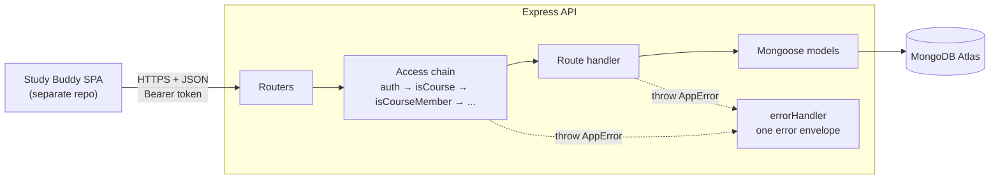
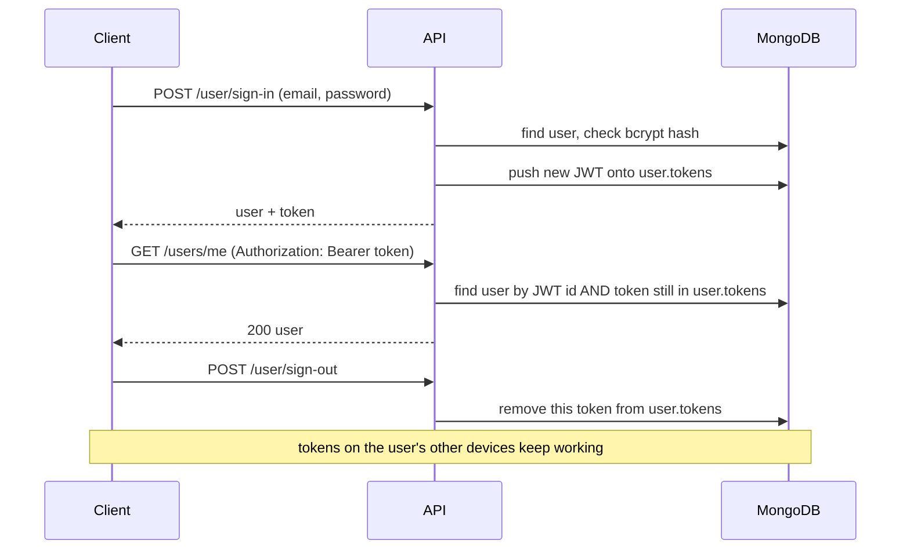
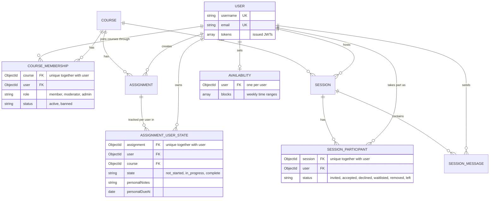

# Study Buddy API

[](https://github.com/CJKBartels/Study-Buddy-API-Server/actions/workflows/ci.yml)

Study Buddy helps students in the same course find each other and get work done together. You join a course with a join code, post and track assignments with your classmates, and set up study sessions with invites, RSVPs, and a session chat.

This repo is the REST API: Express 5, MongoDB through Mongoose, and JWT auth. The frontend lives in [Study-Buddy](https://github.com/CJKBartels/Study-Buddy).

## Architecture



Every request passes through an access chain of middleware before it reaches a handler. Errors thrown along the way end up in one error handler, which turns them into a single JSON shape.

Sign-in issues a JWT and stores it on the user, which is what makes per-device sign-out possible:



## Data model

9 Mongoose models. The 3 join collections (`CourseMembership`, `AssignmentUserState`, `SessionParticipant`) carry most of the rules, and each has a compound unique index so the database itself rejects duplicates.



## Design decisions

### Per-user progress lives in its own model

Assignments are shared by the whole course. Any member can post one, and moderators can stamp it as official. Progress is personal, though: my "in progress" and my notes shouldn't change what you see.

So `AssignmentUserState` holds one document per (assignment, user) pair, with the state, personal notes, and a personal due date. A unique index on `(assignment, user)` makes duplicates impossible, and a single model method, `findOrCreate`, is the only code that creates these documents. It's an atomic upsert, so two first visits at the same moment still produce one document.

**Tradeoff:** every view of a user's assignments reads two collections and combines them in code. Embedding a progress array in each assignment would make that a single read, but then every student's update would rewrite the same shared document.

### Tokens live on the user so one device can sign out

A JWT stays valid until it expires, and the server has no built-in way to take one back.

Every sign-in pushes its token onto `user.tokens`. The `auth` middleware accepts a token only if its signature checks out and it's still in that array. Signing out removes that one token, so signing out on your laptop leaves your phone signed in. Tokens expire after 7 days, and expired ones are removed at the next sign-in.

**Tradeoff:** every authenticated request needs a database lookup to confirm the token is still on the user. That's the price of revocable tokens, and it's the main thing short-lived, lookup-free JWTs avoid.

### Access checks are a middleware chain that loads documents

Almost every route has to answer the same questions before doing anything. Are you signed in? Does this course exist? Are you a member, a moderator, banned?

Each question is one middleware. It validates the id, loads the document, rejects with the right error, and attaches what it loaded to `req` (`req.user`, `req.course`, `req.courseMembership`). A route's access policy is readable straight off its definition:

```js
router.patch('/courses/:courseId/sessions/:sessionId',
    auth, isCourse, isCourseMember, isSession, isSessionHost,
    handler)
```

Handlers trust what's on `req` instead of checking again.

**Tradeoff:** the checks are written against Express's `req` and `res`, so a second way in can't reuse them. Real-time messaging over WebSockets will need them pulled out into plain functions that both paths call.

### Errors are defined in one place

Every error code, with its HTTP status and default message, lives in one registry (`src/assets/errorCodes.js`). A route reports a failure by throwing `new AppError('COURSE_NOT_FOUND')`, and a central error middleware turns thrown errors into one shape:

```json
{ "error": { "code": "COURSE_NOT_FOUND", "message": "Course does not exist" } }
```

That includes errors the code never throws itself: Mongoose validation, cast, and duplicate-key errors, JWT errors, and malformed JSON. Express 5 forwards rejected async handlers to the error middleware, so routes don't need try/catch. The frontend can branch on `code` instead of parsing messages.

## Testing

Model and integration tests run with Vitest. Router tests drive the real Express app through supertest: create a user, sign in, use the token. So `auth` and the access chain run in every test, the same way they do in production.

The database is a real `mongod` that [mongodb-memory-server](https://github.com/typegoose/mongodb-memory-server) starts in memory. Tests never touch Atlas and need no setup, and every collection is wiped before each test.

The suite covers:

- sign-up, sign-in, and sign-out, including revoking one token while others keep working
- role checks: members can't do moderator or admin actions, and non-members can't see a course's members, assignments, or join code
- per-user state: one user's progress never shows up for another
- validation failures and the error envelope

CI runs lint and the full suite on every pull request into `main`. `main` only accepts pull requests that pass.

## Running locally

You need Node 24 (what CI uses) and a MongoDB connection string, either Atlas or a local `mongod`.

```sh
cp .env.example .env   # fill in MONGODB_URL and JSON_WEB_TOKEN_SECRET
npm install
npm run dev            # starts on PORT from .env (3000 in the example)
```

Interactive API docs (Swagger UI) are at `http://localhost:3000/api-docs`.

```sh
npm test               # full suite once, no database needed
npm run test:watch     # re-run on save
npm run lint
```

## Running with Docker

This needs only Docker. Compose starts the API and its own MongoDB, so you don't need Node, a local `mongod`, or Atlas.

```sh
cp .env.example .env        # set JSON_WEB_TOKEN_SECRET; Compose sets PORT and MONGODB_URL itself
docker compose up --build   # API on http://localhost:3000, docs at /api-docs
docker compose down         # stop; add -v to also delete the database
```

The production image comes from the same [Dockerfile](Dockerfile) and contains only `src`, `swagger.js`, and the runtime dependencies. CI builds it on every PR. The Node version is set in 3 places (the Dockerfile, `.github/workflows/ci.yml`, and `engines` in `package.json`), so change them together.

## API at a glance

| Area | Routes |
| --- | --- |
| Accounts | `POST /users`, `POST /user/sign-in`, `POST /user/sign-out`, `/users/me` |
| Courses | `/courses`, `POST /courses/join/:joinCode`, `/courses/:courseId/members` |
| Assignments | `/courses/:courseId/assignments`, your progress at `/courses/:courseId/my/assignments`, everything across courses at `GET /assignments` |
| Study sessions | `/courses/:courseId/sessions`, with participants, invites, RSVPs, and messages underneath |
| Availability | `/availability/me` |

## Roadmap

Work is tracked in the [Revamp milestone](https://github.com/CJKBartels/Study-Buddy-API-Server/milestone/1). Real-time session chat over WebSockets comes after it.

## License

[MIT](LICENSE)
